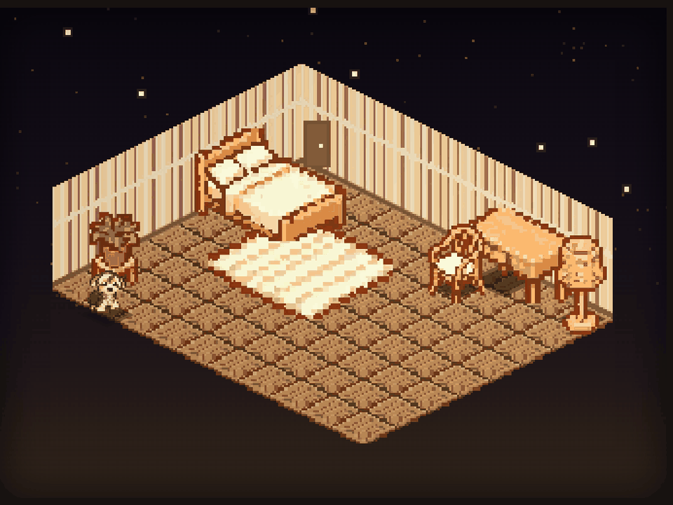
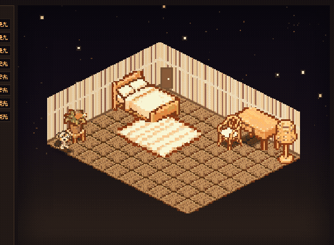
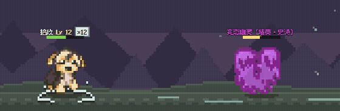
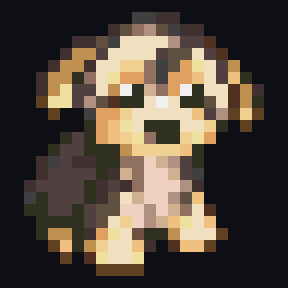
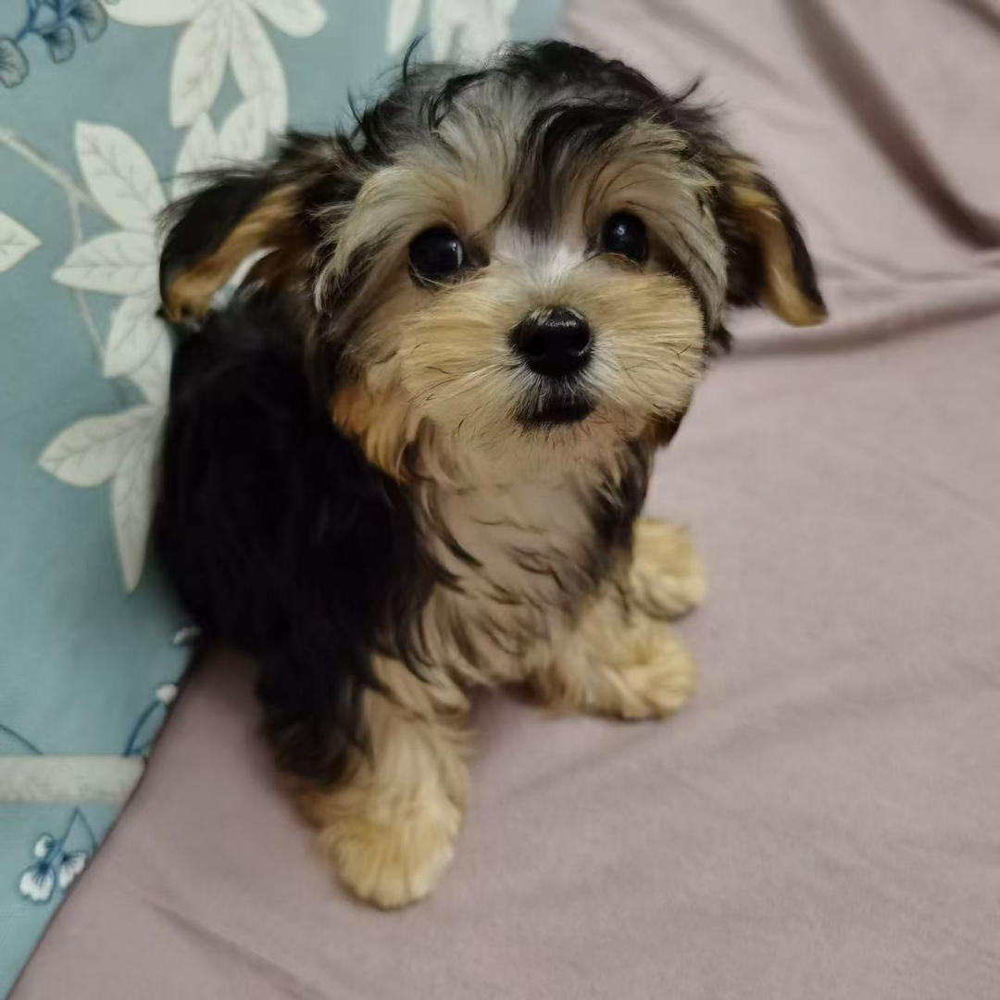

# Nibble · 住在编辑器里的像素小狗

[](https://open-vsx.org/extension/nibble/nibble)
[](https://open-vsx.org/extension/nibble/nibble)
[](https://lmluo.github.io/nibble/)

一只像素小狗，住在 **CodeBuddy / VS Code** 的**状态栏**和**底部面板**里。
你每次向 AI 提问（或保存文件），它就**打一只怪**——升级、掉武器、捡技能书、收集图鉴，进度跨会话保存。
打下来的战利品可以装进**等距 2.5D 的小屋**：它会在屋里自己走动、追球、趴睡、打哈欠，你把家具逐件摆成自己的风格。
连续提问还会累积**连击**：光环在脚下亮起，专注看得见；怪物也会反击，被击退只是白打一场，不扣任何东西。

## 0.7.0 新增

- **它会在屋里自己过日子**：走动、追球、趴睡、打哈欠，点一下还会蹦
- **离开 72 小时会落灰**：回来自己打扫，还从角落翻出一件家具送你
- **战斗里也有表情了**：施放张嘴发狠、挨打闭眼、击杀欢呼

<p></p>
<p></p>
<p></p>

**👉 官网（不用装就能玩）：[lmluo.github.io/nibble](https://lmluo.github.io/nibble/)**
把一句报错丢进去，看它变成哪只怪、拾玖当场开打——纯在浏览器里算，不上传、不联网。

<p></p>

## 它是谁：我的狗「拾玖」

游戏里这只像素小狗，是照着我家的狗画的——**约克夏串串**，名字叫 **拾玖**。

<p></p>

照着它的样子画的像素画（AI 生成），收成 24×24 像素（19 色），就成了游戏里的样子。它平时陪我写代码，现在也顺便帮你打工。

## 安装

**方式 1：装扩展（推荐，开箱可用）**

| 你的编辑器 | 去哪装 |
|---|---|
| VS Code | [Visual Studio Marketplace](https://marketplace.visualstudio.com/items?itemName=nibble.nibble) |
| CodeBuddy / VSCodium / Cursor 等 | [Open VSX 市场](https://open-vsx.org/extension/nibble/nibble) |

在两个市场里搜 **Nibble** 即可安装，或命令面板执行 `Extensions: Install from VSIX...` 装本地包。
默认**保存文件即攻击**，不需要其他依赖。

**方式 2：再装本仓库的插件 → 提问即攻击（默认玩法）**

```text
/plugin marketplace add "<本仓库目录>"
/plugin install nibble@nibble-cb
/reload-plugins
/nibble:nibble-setup          # 把像素小狗写进状态栏
```

需要 **Node ≥ 16**；Windows 下 CodeBuddy 的 hooks 走 Git Bash，故需安装 [Git for Windows](https://git-scm.com/download/win)。

> 设置项：`nibble.triggerMode`（`hook` 提问即攻击 / `onSave` 保存即攻击 / `manual` 仅手动）、`nibble.statusBar`、`nibble.tickMs`。

**方式 3：不装编辑器 —— 免安装桌面版（Windows）**

[`nibble-desktop`](https://github.com/LMLuo/nibble-desktop) 是独立的桌面伴生版：**免安装单文件 exe**（约 70 MB），
双击后像素小狗常驻桌面，在**任意程序里**敲空格 / 回车即攻击（只观察不拦截，正常打字完全不受影响）。
去 [Releases](https://github.com/LMLuo/nibble-desktop/releases) 下载 `Nibble-Portable-*.exe` 直接运行；
存档在 `%APPDATA%\Nibble`，**零联网**，与扩展版共用同一套怪物 / 武器 / 技能书设定。

## 怎么玩

| 你做什么 | 它做什么 |
|---|---|
| 提问 / 保存文件 | 攻击一次野生怪物（40 只「编程 Bug」怪物：小怪 / 精英 / 头目） |
| 连续提问（间隔 ≤10 分钟） | 累积**连击**：≥10 连攻击最多 +30%、脚下亮起光环；≥25 连转亮金并加速武器保底；≥50 连触发超载演出。断连静默归零，不惩罚 |
| 击败敌人 | 升级；**20% 概率掉 1 把武器**（普通 70% / 稀有 22% / 史诗 7% / 传说 1%，40 击未出史诗以上保底必出；空武器库首击必得） |
| 收集武器 | 80 把各有独立像素图 + 一段小故事；面板「🎒 武器库」按稀有度分组查看 |
| 武器有用 | 每把武器提供**战力**（普通 +8% / 稀有 +15% / 史诗 +25% / 传说 +40% 攻击加成）；不手动装也会自动取已拥有里最强的那把 |
| 挑一把带上 | 武器库详情卡点「装备此武器」可固定携带（图鉴里有 ★ 标记），否则自动用战力最高的那把 |
| 遭遇 / 击败怪物 | 自动收录进「📖 怪物库」：已击败点亮为彩色并累计次数，点选可读它的「Bug 纪要」 |
| 击败敌人（10% 概率） | 再掉一本**技能书**：共 50 本、9 种标签、12 条组合；「📖 技能书」页收集，可装配 **4 个技能槽**（空槽 = 普攻） |
| 怪物反击 | 你也有血量（`30 + 等级×6`，**击杀即回满**）；见底只是**被击退一场**——满血、换新怪、不降级、不丢武器 / 收集进度 |
| 装修小屋 | 「🏠 小屋」页等距 2.5D 装修：**8 槽位**（地板 / 墙纸 / 床铺 / 桌子 / 椅子 / 灯 / 地毯 / 摆件）× 5 套共 40 件 + 20 件通用装饰，家具击败掉落（5% 概率 + 25 只保底）；拖动吸附摆放、`Ctrl+Z` 撤销、仓库右侧抽屉「边看边摆」 |
| 它在屋里过日子 | 小狗会走动 / 玩耍 / 休息 / 搞怪（绕开家具，点它会冒心）；连续 **72 小时**没活动会落灰、趴睡，下次提问时自己醒来打扫，并送你**一件未拥有的家具**（一次性，不惩罚） |

命令：`Nibble: 攻击一次`、`Nibble: 打开武器库`、`Nibble: 打开怪物库`、`Nibble: 打开技能书`、`Nibble: 打开小屋`、`Nibble: 重置进度`。

## 隐私

**不读**你的代码、提示词、文件路径或文件内容。只在你**每天第一次打开编辑器**时发送 2 个字段——
**匿名 ID（本机随机生成）+ 版本号**；可在设置中一键关闭，上报失败一律静默忽略。

## 支持作者

如果这只小狗陪你写过几行代码，欢迎请拾玖吃根肉干 🦴

<p></p>

<sub>打赏纯属自愿。所有玩法（升级、武器库、收集）都是免费的，不影响任何功能。</sub>

## 更多

| 想看什么 | 去哪 |
|---|---|
| 官网 + 在线演示（不用装就能玩） | [lmluo.github.io/nibble](https://lmluo.github.io/nibble/) |
| 怎么发版：改版本号 → 打 tag → CI 自动上架 | [`PUBLISHING.md`](PUBLISHING.md) |
| 玩法升级规划：武器库 / 装备 / 连击 / 技能书 / 玩家血量与反击 / 小屋 | [`docs/游戏升级规划/`](docs/游戏升级规划/) |
| 素材来源与版权（含拾玖照片的许可口径） | [`legacy-mods/CREDITS.md`](legacy-mods/CREDITS.md) |

设计灵感来自 [Spinlings](https://spinlings.dev/)（视觉语言与"随 AI 工作节奏推进"的交互思路）；本项目名称、代码与素材均为独立创作。
